# QuanPieces

New building pieces for the things the vanilla build menu can't quite do. Each one exists because it solves a
real building problem, and they all live in their own **QuanPieces** tab on the hammer.

Everyone on a server needs the mod installed: the server and every player connecting to it.

## Pieces

<b>Quan's Chimney Flue</b>

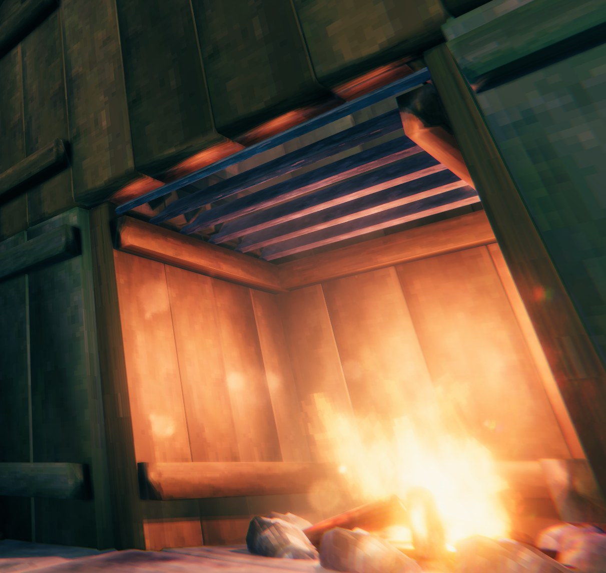

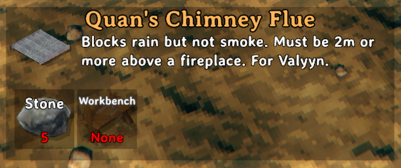

A 2x2 chimney flue that sits above your fireplace, inside your chimney, and stops the rain putting out your
fire whilst still letting the smoke escape. No longer do you need a roof over your chimneys!

| Cost | Crafting station | Size |
|---|---|---|
| 5 Stone | Workbench | 2x2, snaps and tiles with itself to make larger flues |

> **Place it at least 2 m above your fire**, so the smoke can form without putting the fire out.

- It only needs to cover the space directly above the fire. For wider chimneys, snap several together to
  fill the opening.
- It doesn't change how smoke behaves: a chimney that backs smoke up without the flue still will with it.
- You can walk on it like a grate, and so can creatures; items dropped on it stay there. Smoke still rises
  straight through.

<b>Quan's Street Lights</b>

<table>
<tr>
<td>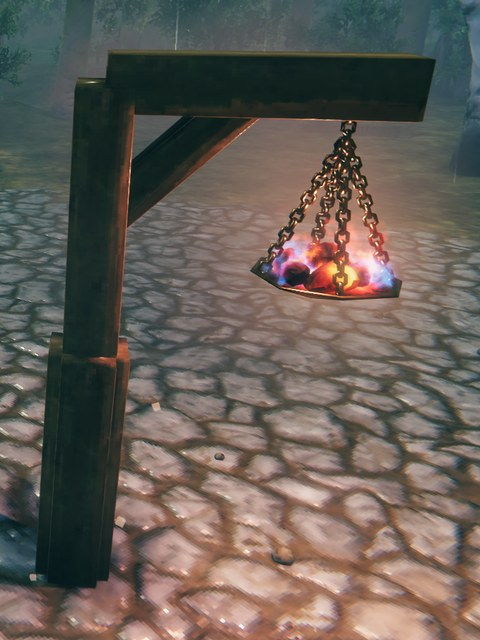</td>
<td>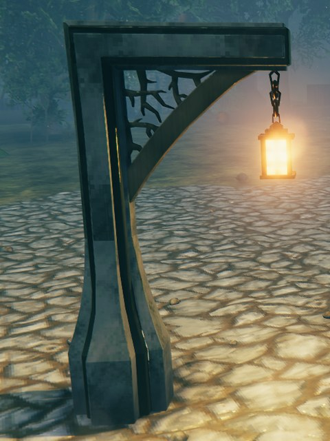</td>
</tr>
<tr>
<td>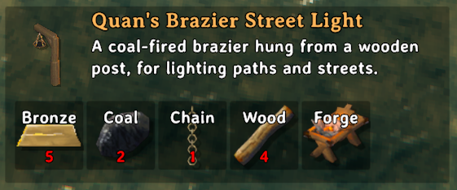</td>
<td>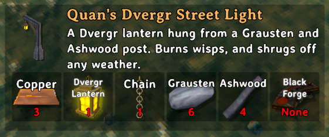</td>
</tr>
</table>

Two street lights for lighting paths, roads and the spaces between buildings: a coal brazier for the middle of
the game and a Dvergr lantern for later on. Both work like any other fire, so you refuel them by hand, and with
[NoSmokeStayLit](https://thunderstore.io/c/valheim/p/TastyChickenLegs/NoSmokeStayLit/) you can put them on its
day/night timer or keep them lit.

| | Brazier Street Light | Dvergr Street Light |
|---|---|---|
| **Cost** | 5 Bronze, 2 Coal, 1 Chain, 4 Wood | 3 Copper, 1 Dvergr Lantern, 1 Chain, 6 Grausten, 4 Ashwood |
| **Crafting station** | Forge | Black Forge |
| **Fuel** | Coal | Wisps |
| **Rain** | Stays lit, sheltered by its arm | Stays lit |
| **Strong wind** | Burns low, like any open fire | Stays lit, it's enclosed |
| **Light** | A little brighter and wider than a hanging brazier | A wide pool: lamps about 30 m apart light the whole path |
| **Warmth** | Up to 8 m away, like a hanging brazier | Up to 50 m away, so whole paths stay warm |

- Both stand on the ground or on floors, and need the same support as a wooden post.
- They're 4 m tall, with the light hanging 2.5 to 3 m up.
- To use them with NoSmokeStayLit's timer, add `Quan_streetlight_brazier` and `Quan_streetlight_lantern` to its
  **Custom Items on Timers** setting.

<b>Quan's Planters</b>

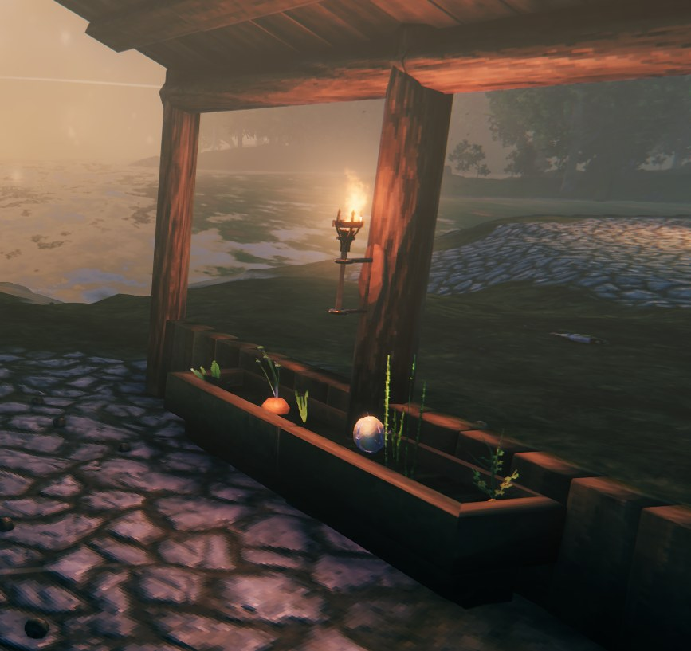

<table>
<tr>
<td>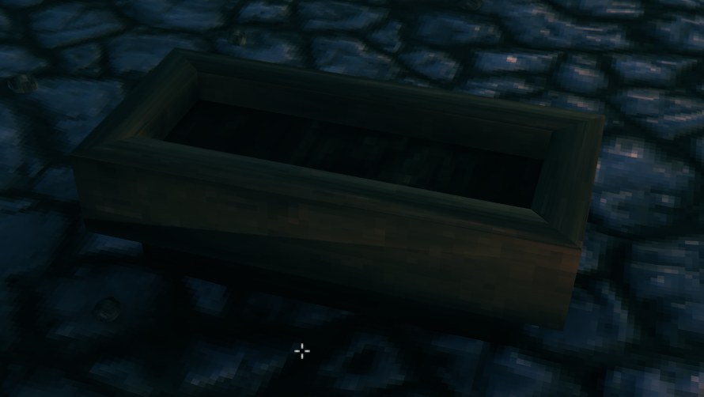</td>
<td>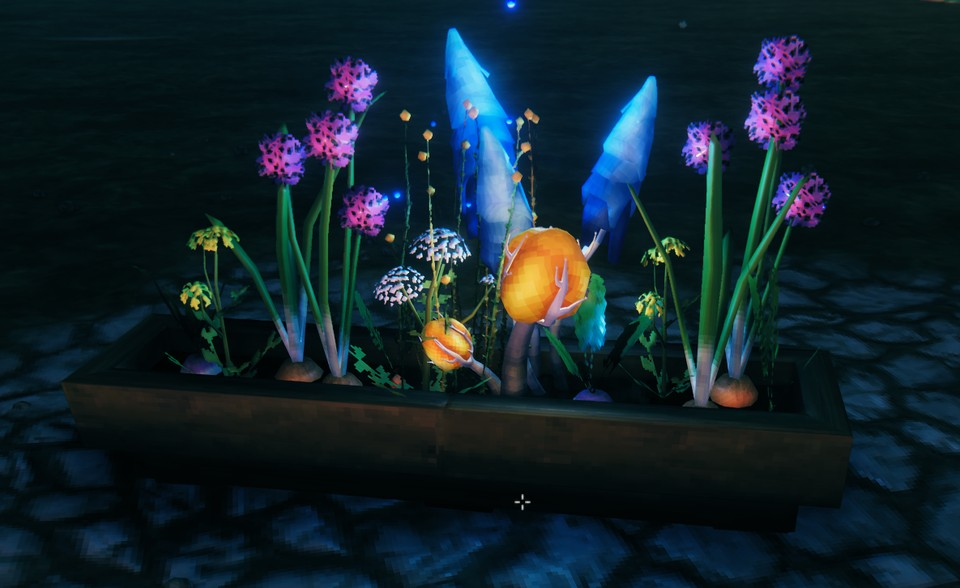</td>
</tr>
<tr>
<td>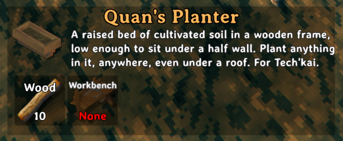</td>
<td>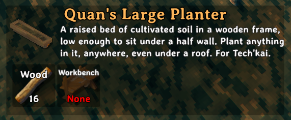</td>
</tr>
</table>

Raised beds of cultivated soil for growing crops wherever you build: in a greenhouse, along a terrace, or tucked
under the eaves in front of a half wall. Plant straight into them with the cultivator, no hoe needed.

| | Planter | Large Planter |
|---|---|---|
| **Size** | 1x2 | 1x4 |
| **Cost** | 10 Wood | 16 Wood |
| **Crafting station** | Workbench | Workbench |

- Anything you can plant with the cultivator grows in them, in any biome, with no heat or cold damage.
- They work under a roof, so you can farm indoors.
- Pack your crops in as tightly as you like: plants in a planter don't crowd each other, and nearby walls and
  other building pieces don't crowd them either.
- They're 80 cm tall, low enough to sit under a 1 m half wall. They snap to the floor grid and to each other, and
  need the same support as a wooden floor.
- Removing a planter clears it: seedlings give back their seeds, and anything ready to pick drops its harvest.
  Other mods' plants (such as PlantEverything's) give back whatever that mod gives when you remove them.

<b>Quan's Chicken Coop</b>

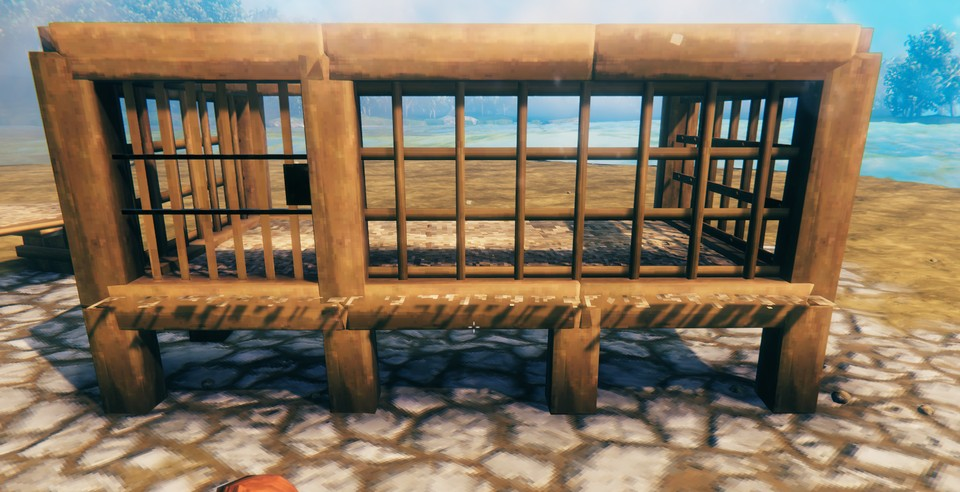

<table>
<tr>
<td>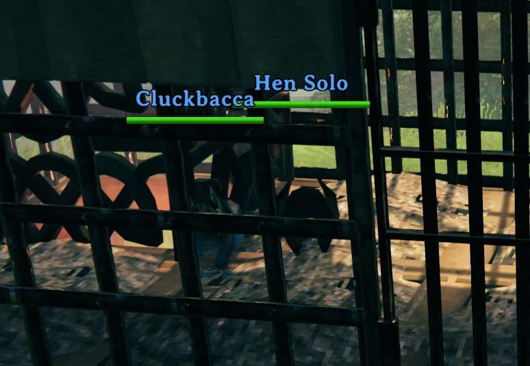</td>
<td>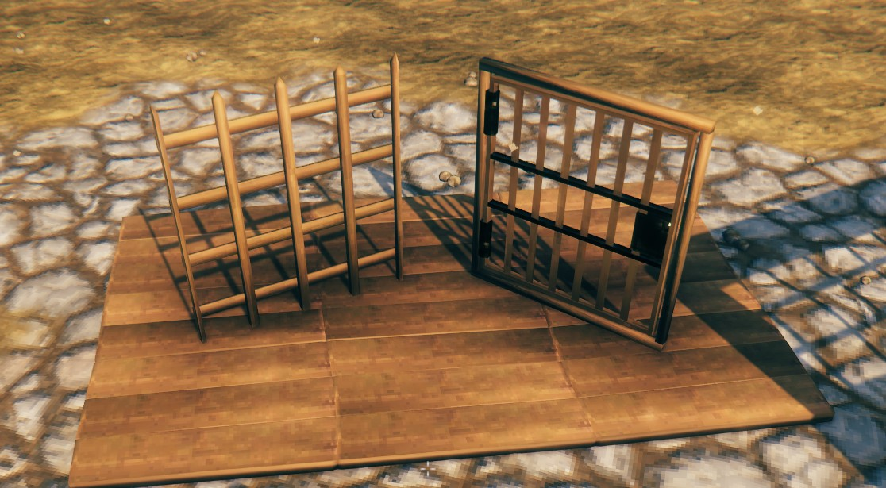</td>
<td>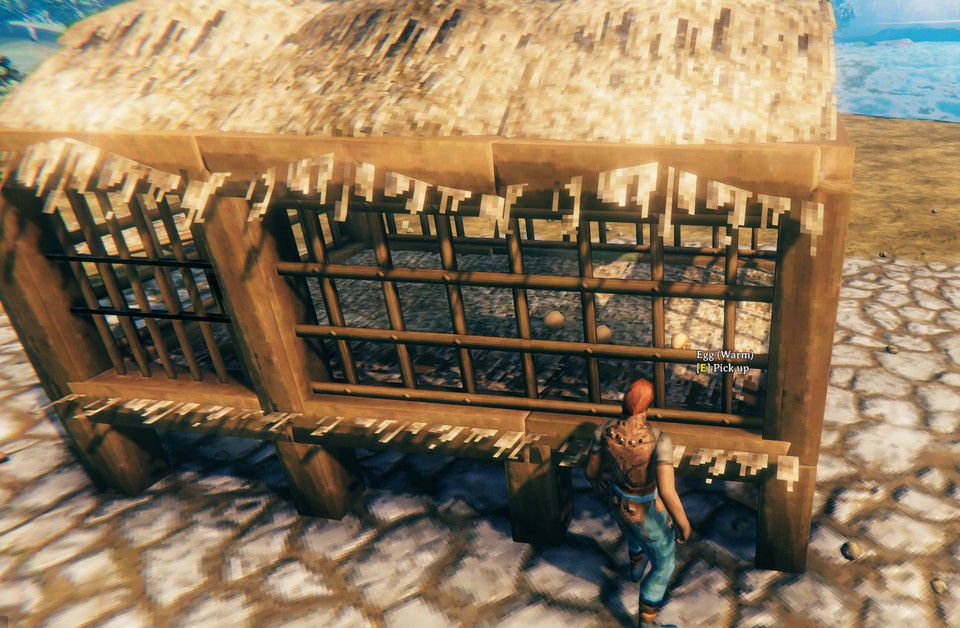</td>
<td>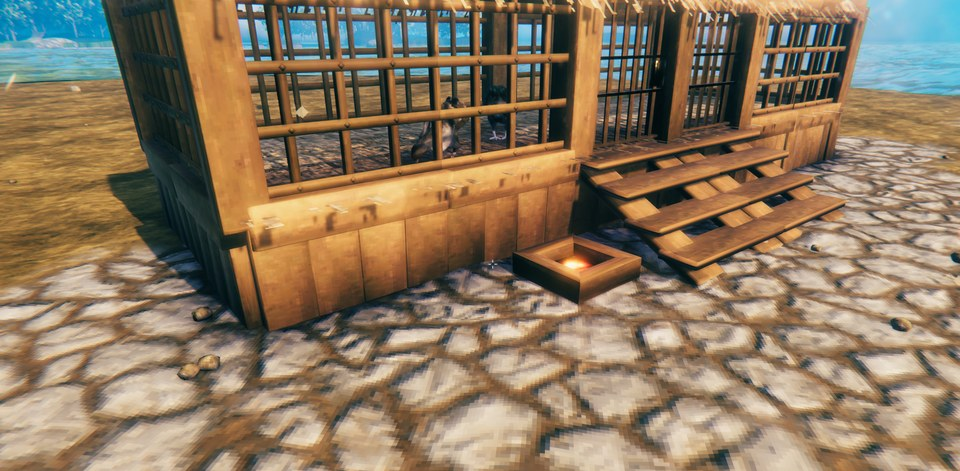</td>
</tr>
<tr>
<td>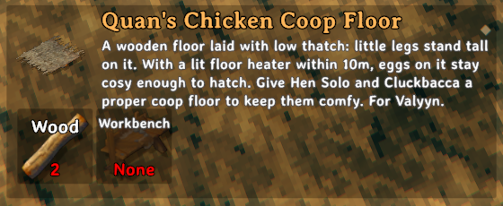</td>
<td>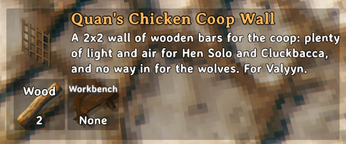</td>
<td>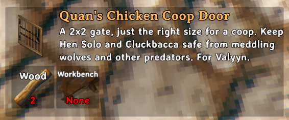</td>
<td>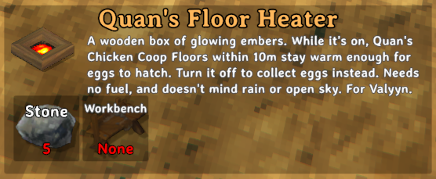</td>
</tr>
</table>

Pieces for giving your chickens a proper home: a thatched floor, a heater to warm it, walls of wooden bars and a
gate to match.

| | Coop Floor | Floor Heater | Coop Wall | Coop Door |
|---|---|---|---|---|
| **Size** | 2x2 | 1x1 | 2x2 | 2x2 |
| **Cost** | 2 Wood | 5 Stone | 2 Wood | 2 Wood |
| **Crafting station** | Workbench | Workbench | Workbench | Workbench |

- **Floor**: a wooden floor with the thatch laid low, so even chicks stand tall on it. While a floor heater
  that's on is within 10 m, it gives off warmth like a fire, so eggs laid on it hatch. As in vanilla, they also
  need a roof over them. Without a heater nearby it stays cold, and eggs on it wait to be collected.
- **Floor Heater**: a small wooden box of glowing embers. It's built switched off; use it to turn it on or off: on,
  the coop floors around it are warm and eggs hatch; off, they go cold, eggs stop hatching (an egg that's already
  growing starts again from scratch), and you can collect them. It needs no fuel and doesn't mind rain, wind, smoke
  or open sky, so it can sit under the edge of a raised coop or out in the open beside it. Its hover text shows how
  many coop floors it's warming.
- **Wall**: wooden bars that let the light and air in and keep animals in or out. You can see and reach through
  them, so you can pick up eggs from outside the coop.
- **Door**: a 2x2 gate of wooden bars with an iron latch. It opens and closes like any door.
- They snap like vanilla 2x2 floors and walls, and need the same support as other wooden pieces.

<b>Quan's Plank Walls</b>

The vanilla wood walls with nothing but their vertical planks: no horizontal beams across the back. The same
look, the same wear states as they take damage, the same support and snapping, plus two taller walls.

| | Wood Wall | Wood Wall Half | Wood Wall 1x1 | Wood Wall 2x3 | Wood Wall 1x3 |
|---|---|---|---|---|---|
| **Size** | 2x2 | 2x1 | 1x1 | 2 m wide, 3 m tall | 1 m wide, 3 m tall |
| **Cost** | 2 Wood | 1 Wood | 1 Wood | 3 Wood | 2 Wood |
| **Crafting station** | Workbench | Workbench | Workbench | Workbench | Workbench |

- The 2x2, half and 1x1 walls are vanilla's, minus the beams, so they sit happily beside vanilla walls.
- The 3 m walls' planks are longer, not stretched: the wood grain carries on up the extra height at the same
  scale as the 2x2 wall's, so a 2x3 next to a 2x2 matches.

