# QuanPieces

New building pieces for the things the vanilla build menu can't quite do. Each one exists because it solves a
real building problem, and they all live in their own **QuanPieces** tab on the hammer.

Everyone on a server needs the mod installed: the server and every player connecting to it.

## Pieces

<b>Quan's Chimney Flue</b>

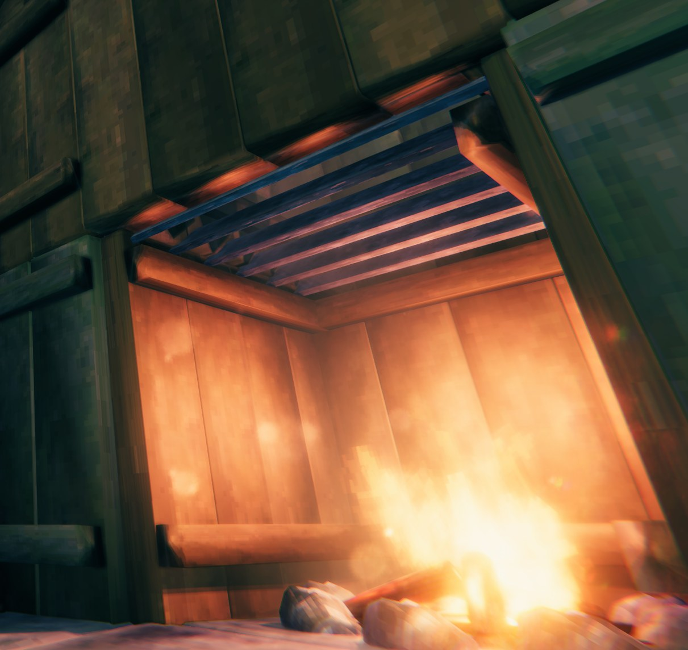

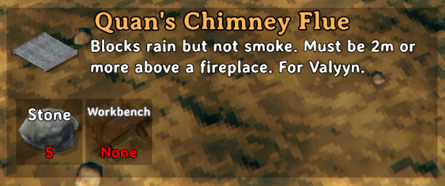

A 2x2 chimney flue that sits above your fireplace, inside your chimney, and stops the rain putting out your
fire whilst still letting the smoke escape. No longer do you need a roof over your chimneys!

| Cost | Crafting station | Size |
|---|---|---|
| 5 Stone | Workbench | 2x2, snaps and tiles with itself to make larger flues |

> **Place it at least 1.5 m above your fire**, so the smoke can form without putting the fire out.

- It only needs to cover the space directly above the fire. For wider chimneys, snap several together to
  fill the opening.
- It doesn't change how smoke behaves: a chimney that backs smoke up without the flue still will with it.
- You can walk through it. Only its edges are solid.

<b>Quan's Street Lights</b>

<table>
<tr>
<td>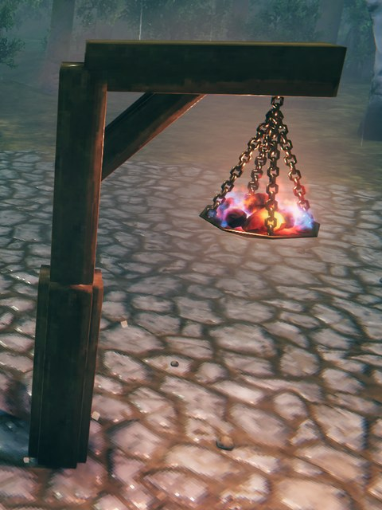</td>
<td>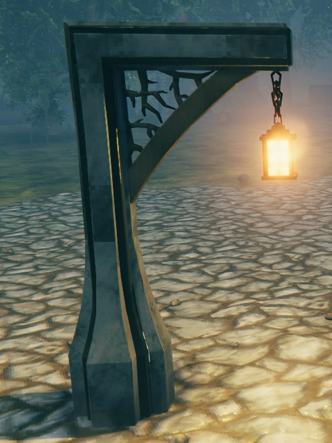</td>
</tr>
<tr>
<td>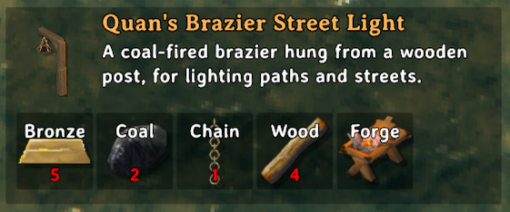</td>
<td>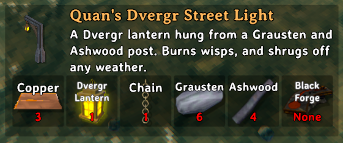</td>
</tr>
</table>

Two street lights for lighting paths, roads and the spaces between buildings: a coal brazier for the middle of
the game and a Dvergr lantern for later on. Both work like any other fire, so you refuel them by hand, and with
[NoSmokeStayLit](https://thunderstore.io/c/valheim/p/TastyChickenLegs/NoSmokeStayLit/) you can put them on its
day/night timer or keep them lit.

| | Brazier Street Light | Dvergr Street Light |
|---|---|---|
| **Cost** | 5 Bronze, 2 Coal, 1 Chain, 4 Wood | 3 Copper, 1 Dvergr Lantern, 1 Chain, 6 Grausten, 4 Ashwood |
| **Crafting station** | Forge | Black Forge |
| **Fuel** | Coal | Wisps |
| **Rain** | Stays lit, sheltered by its arm | Stays lit |
| **Strong wind** | Burns low, like any open fire | Stays lit, it's enclosed |
| **Light** | A little brighter and wider than a hanging brazier | A wide pool: lamps about 30 m apart light the whole path |
| **Warmth** | Up to 8 m away, like a hanging brazier | Up to 50 m away, so whole paths stay warm |

- Both stand on the ground or on floors, and need the same support as a wooden post.
- They're 4 m tall, with the light hanging 2.5 to 3 m up.
- To use them with NoSmokeStayLit's timer, add `Quan_streetlight_brazier` and `Quan_streetlight_lantern` to its
  **Custom Items on Timers** setting.

<b>Quan's Planters</b>

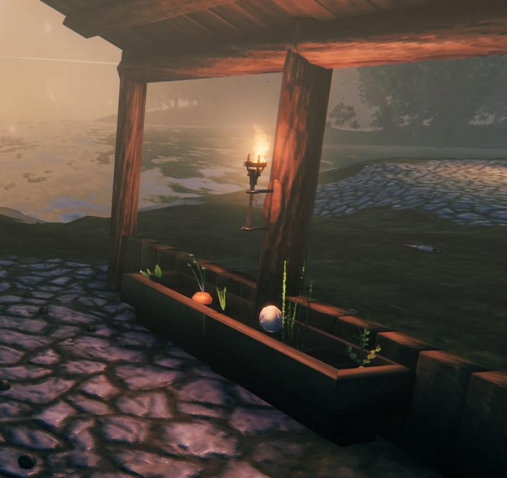

<table>
<tr>
<td>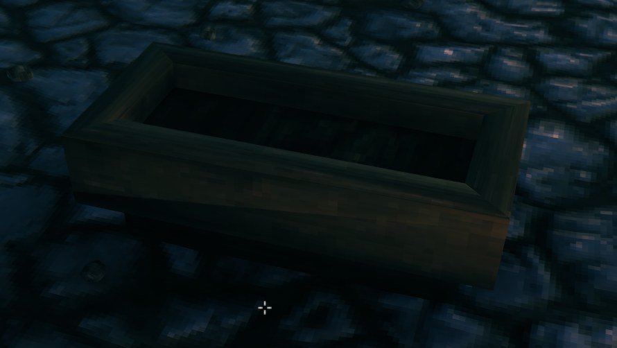</td>
<td>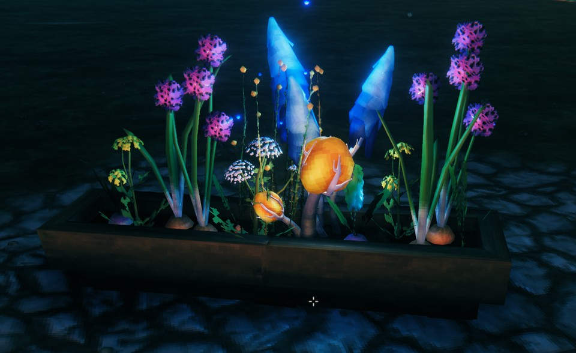</td>
</tr>
<tr>
<td>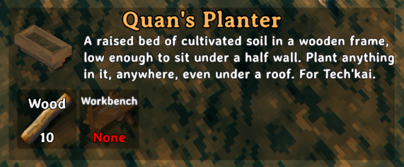</td>
<td>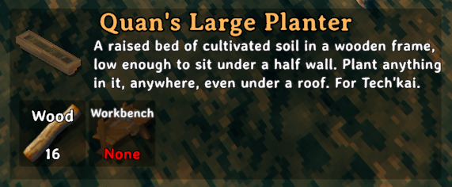</td>
</tr>
</table>

Raised beds of cultivated soil for growing crops wherever you build: in a greenhouse, along a terrace, or tucked
under the eaves in front of a half wall. Plant straight into them with the cultivator, no hoe needed.

| | Planter | Large Planter |
|---|---|---|
| **Size** | 1x2 | 1x4 |
| **Cost** | 10 Wood | 16 Wood |
| **Crafting station** | Workbench | Workbench |

- Anything you can plant with the cultivator grows in them, in any biome, with no heat or cold damage.
- They work under a roof, so you can farm indoors.
- Pack your crops in as tightly as you like: plants in a planter don't crowd each other, and nearby walls and
  other building pieces don't crowd them either.
- They're 80 cm tall, low enough to sit under a 1 m half wall. They snap to the floor grid and to each other, and
  need the same support as a wooden floor.
- Removing a planter gives back the seeds of anything still growing in it. Fully grown crops drop to the ground,
  ready to pick.

<b>Quan's Chicken Coop</b>

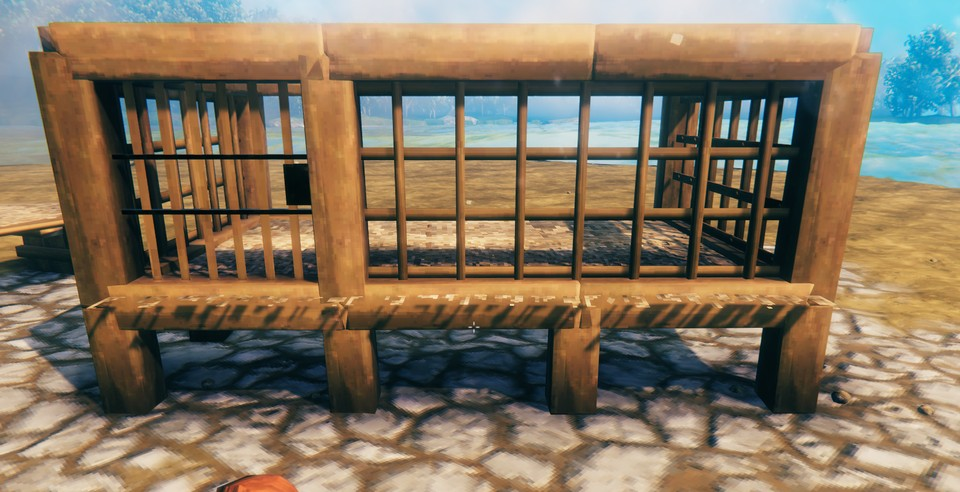

<table>
<tr>
<td>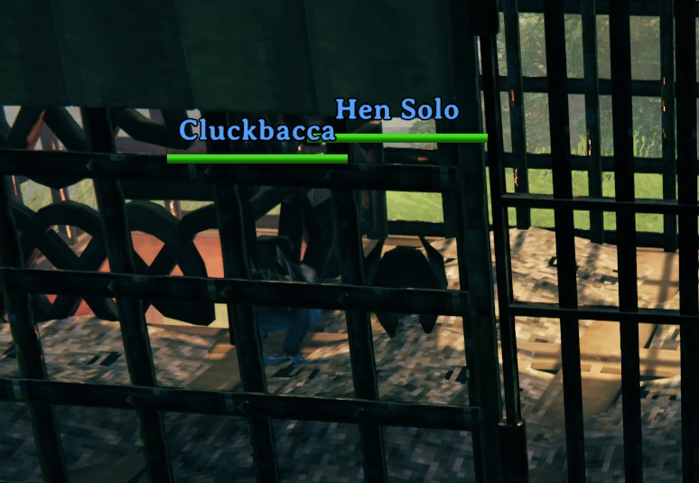</td>
<td>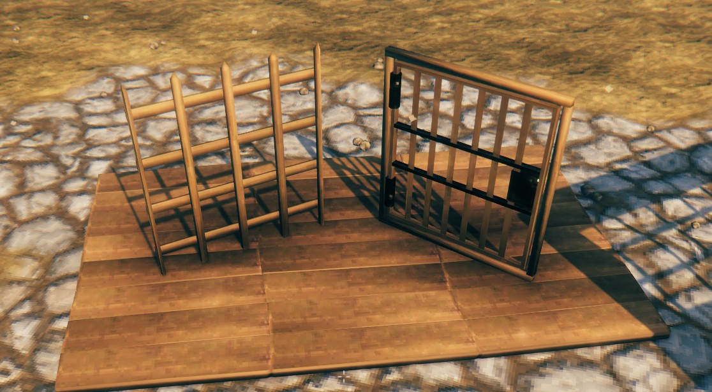</td>
<td>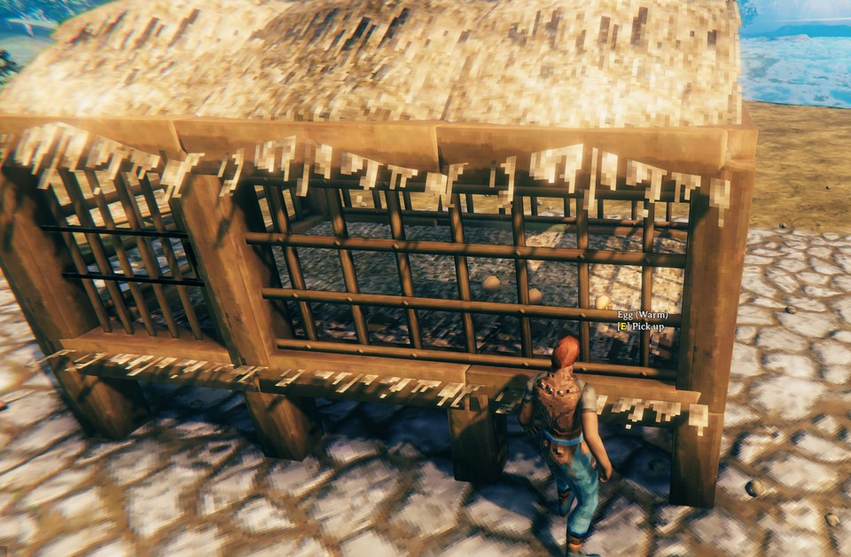</td>
</tr>
<tr>
<td>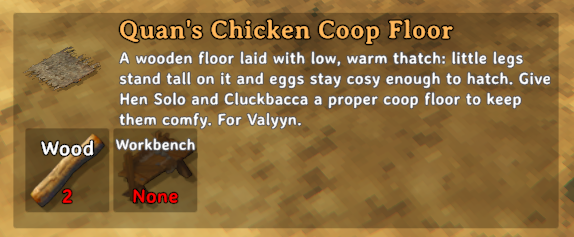</td>
<td>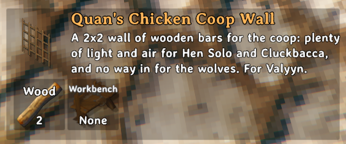</td>
<td>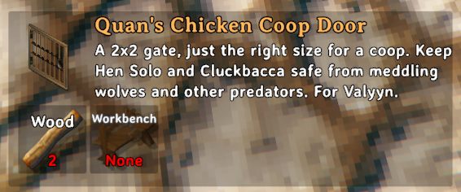</td>
</tr>
</table>

Three pieces for giving your chickens a proper home: a warm thatched floor, walls of wooden bars and a gate to
match.

| | Coop Floor | Coop Wall | Coop Door |
|---|---|---|---|
| **Size** | 2x2 | 2x2 | 2x2 |
| **Cost** | 2 Wood | 2 Wood | 2 Wood |
| **Crafting station** | Workbench | Workbench | Workbench |

- **Floor**: a wooden floor with the thatch laid low, so even chicks stand tall on it. It gives off warmth like
  a fire, so eggs laid on it hatch. As in vanilla, they also need a roof over them. Standing on it warms you too.
- **Wall**: wooden bars that let the light and air in and keep animals in or out. You can see and reach through
  them, so you can pick up eggs from outside the coop.
- **Door**: a 2x2 gate of wooden bars with an iron latch. It opens and closes like any door.
- They snap like vanilla 2x2 floors and walls, and need the same support as other wooden pieces.

## For developers

A BepInEx/Jotunn mod. Each piece lives in its own class under `Pieces/`, Harmony patches under `Patches/` and shared mesh code under `Meshes/`. The Thunderstore page is
`Package/README.md`; keep its player-facing text in step with the sections above. Build and release steps are in
`docs/DEVELOPMENT.md`.

### How the pieces work

<b>Quan's Chimney Flue</b> (<code>Quan_chimney_flue</code>)

A clone of the vanilla iron cage floor (`iron_floor_2x2`), with its bars replaced by a generated stone frame and
angled louvres (`Meshes/BoxMesh.cs`, no colliders), that blocks rain from a fire without stopping its smoke.
It relies only on vanilla behaviour, no patches:

- A fire is "wet" when `Cover.IsUnderRoof`'s thin sphere cast straight up from it hits nothing. A wet fire
  shows its low flame only: no warmth, no cooking area and no smoke spawner.
- Valheim's physics settings have `queriesHitTriggers` on, so a trigger collider on the `piece` layer counts as
  a roof. Smoke puffs are rigidbodies about 0.84 m across that collide with pieces but not with triggers.
- `Cover.IsUnderRoof` skips colliders tagged `leaky`, and the cage floor is tagged `leaky` because rain falls
  through its bars. The flue clears that tag so its slab counts as a roof.
- The flue's slab collider is a trigger. Thin solid strips along its edges give `WearNTear` support (it
  ignores triggers) and give the hammer something to hit.
- Its `WearNTear` material type is wood, despite the stone look. Stone needs at least 100 support, which
  wooden walls can never supply, so a stone flue would fall out of a wooden chimney. Its sounds and particles
  come from the stone floor.
- The louvres use a copy of the stone floor's material with `_RippleDistance` set to 0. Stone pieces otherwise
  wobble each vertex by up to 0.1 m, which pulled the generated boxes apart at their joins. Their UVs map into
  the opaque regions of the stone floor's texture atlas, because the rest of the atlas is partly transparent.
- `Fireplace` treats anything, triggers included, within about 0.5 m above its cover check point as a
  blockage, hence the 1.5 m placement rule.

<b>Quan's Street Lights</b> (<code>Quan_streetlight_brazier</code>, <code>Quan_streetlight_lantern</code>)

Both clone the vanilla hanging brazier (`piece_brazierceiling01`), so they're built on the game's own `Fireplace`
component, the same one every vanilla fire and torch uses: fuel, the add-fuel interaction, and the on/off
switching of light, warmth and effects. Many modded light sources are just a light with no `Fireplace`, so they
sit outside the game's fire behaviour. These street lights behave like vanilla light sources, so any mod that
works with vanilla fires and torches (fuel, lit state, timers and so on) can work with them too. The piece origin
moves to the foot of the post, so `m_disableCoverCheck` is on: the blocked check would otherwise hit the post
itself.

**Brazier street light** (`Pieces/BrazierStreetlight.cs`):

- The frame is the vanilla pole and beam meshes, placed and scaled: two stacked 2 m poles, a 2 m arm, a 45°
  brace at 75% thickness, and four foot poles 75% inside the post.
- The brazier hangs from the arm. Its mesh is copied with the top nine links of its vertical chain removed
  (islands on the centre line above a cut height), so its chain meets the arm.
- The arm's collider is added by the mod and untagged, so it counts as a roof: rain doesn't dim it, but strong
  wind still does (vanilla rule). Vanilla beams are tagged `leaky` and don't shelter.
- Light range 12 m (the brazier's own is 10 m).

**Dvergr street light** (`Pieces/LanternStreetlight.cs`):

- All brazier visuals are stripped. With no high/low flame objects the `Fireplace` never runs its wet check, so
  it's weatherproof. Fuel is Wisp, at the brazier's burn rate.
- The Grausten frame is built from the Grausten Small Pillar, repeated with every other repeat mirrored (no
  joints), mitred at the corner, and welded both ways onto the Tapered Pillar, matching faces by direction so
  the carved star keeps its shading. All the Grausten uses a triplanar copy of its material, so the texture is
  continuous across every piece. The Tapered Pillar's inner notch faces are split off (whole flat faces, not
  triangles) and textured as Ashwood.
- The Ashwood cores are the Ashwood pole stretched to 4 m and 2.2 m.
- The Ashwood Arch is shipped unreadable, so it's used whole, scaled 90% along the beam and post and 75% front to
  back, with its own post and beam hidden inside the cores.
- The lantern and chain are islands lifted from the Dvergr Pole Lantern's mesh. `LanternGlass` swaps its
  material for a copy with emission off while the `Fireplace` is out.
- The light is the Dvergr lantern's, at range 60 m and intensity 1.5, with its `LightLod` switch-off distance
  raised to 80 m. Warmth is the hanging brazier's area at 50 m.
- `Meshes/MeshData.cs` holds the reusable mesh operations (islands, resize, clip, slice, flat faces).

<b>Quan's Planters</b> (<code>Quan_planter_1x2</code>, <code>Quan_planter_1x4</code>)

Both clone the vanilla 1x1 wood floor (`wood_floor_1x1`) for its piece setup (wood support, sounds, placement)
and rebuild it (`Pieces/Planter.cs`). Their only snap points are the four bottom corners.

- The rim is the 2 m beam's cube at half width (0.2 x 0.4 m). Each long side is exact vanilla 2 m beams end to
  end, so their joint looks like vanilla's. At the corners each beam's end is pushed out past the corner and cut
  along the diagonal (`MeshData.Clip`), which makes the mitre and removes that end's bevel.
- The bed is the same cube in the floor's material, one solid block 50 cm deep, reaching 4 cm into the beams. (The
  floor's own mesh is separate planks, which showed gaps when stretched.)
- The soil uses the terrain's own cultivated textures. They exist at runtime only as slices of the terrain's
  texture arrays (`terrain_d_array` slice 10, `terrain_n_array` slice 5), so `PlanterSoil` copies them out on the
  GPU (`Graphics.CopyTexture`) into a copy of the floor's material. That copy has `_Cutoff` at 0, because the
  terrain texture's alpha holds other data and would otherwise punch holes in the soil, and no vertex wobble.

Planting relies on Harmony patches (`Patches/PlanterPatches.cs`), each acting only on points within a few cm of
a planter's soil collider (`Quan_planter_soil`, checked by `PlanterSoil.IsOverSoil`). Vanilla only ever asks the
terrain whether ground is cultivated, so:

- `Heightmap.IsCultivated` returns true on planter soil.
- `Player.PieceRayTest`: when a plant is being placed and the aim hits the soil, the hit is reported as terrain,
  so the vanilla placement checks (and then `IsCultivated`) accept it.
- `Player.UpdatePlacementGhost`: wrong biome and deep snow don't block planting in a planter.
- `Plant.UpdateHealth`: biome, heat and cold are ignored. `Plant.HaveRoof` reports no roof.
- `Plant.HaveGrowSpace`: always has room, apart from vines needing room from other vines. Grown crops must not
  count as obstacles: the game destroys a crop that's unhealthy when it's due to grow.
- `StaticPhysics.Fall`: grown crops on the soil stay put instead of dropping to the terrain.

Each patch class is applied on its own (`QuanPiecesPlugin.ApplyPatches`), so one that stops fitting the game is
logged and skipped without affecting the rest. When a planter is destroyed, `PlanterSoil` (via
`WearNTear.m_onDestroyed`) removes its seedlings and drops their seeds itself: `Piece.DropResources` won't,
because saplings' costs aren't marked recoverable.

<b>Quan's Chicken Coop</b> (<code>Quan_chicken_coop_floor</code>, <code>Quan_chicken_coop_wall</code>, <code>Quan_chicken_coop_door</code>)

**Floor** (`Pieces/ChickenCoopFloor.cs`): the vanilla 2x2 wood floor (`wood_floor`) with the 26° thatch roof's
(`wood_roof`) three straw layers laid flat on top. The straw is taken into the roof's own space and unrolled:
along the slope, the 2.24 m sloped span maps onto the floor's 2 m while the overhang past each edge keeps the
roof's exact length; height above the slope is squashed into a 5 cm layer lying on the planks. The floor's
collider is raised to halfway up the thatch, so small animals stand on it. A trigger box over the floor on the
`character_trigger` layer carries an `EffectArea` of type Heat, which is what `EggGrow` checks for (eggs also need
a roof, checked separately). It costs the same as the thatch roof, read from its recipe.

**Door** (`Pieces/ChickenCoopDoor.cs`): the vanilla Iron Gate (`iron_grate`), 2x3, made 1 m shorter by reshaping
rather than scaling. The frame's top bar drops 1 m and the uprights shorten. The swinging leaf is split into
islands: its outer frame and vertical bars lose 1 m from the middle (their end rails keep their thickness), the
hinges move with the ends, and the cross bars and latch move together, unchanged, to the middle. The frame and
bars are wood; the hinges, cross bars and latch stay iron, on a second renderer beside the leaf.

**Wall** (`Pieces/ChickenCoopWall.cs`): the vanilla Cage Wall 2x2 (`iron_wall_2x2`) with the same meshes in
wood. Its single solid collider keeps animals in and out, so `Patches/SeeThroughPatches.cs` lets the hover look
past it: `Player.FindHoverObject` is re-run, skipping pieces marked `SeeThrough`, when the first thing hit is one.
Hammer aiming uses its own ray and isn't affected.

The door and wall share `Pieces/CoopWood.cs`: 2 Wood at a Workbench (the Cage Wall's 2 Iron, in wood), the wood
pole's materials without vertex wobble (which visibly bends thin bars), and the wood door's support, sounds and
effects. `Meshes/WoodGrain.cs` gives the iron meshes new UVs, mapping each face flat from the side it faces with
the grain along the bar, since their UVs point into a metal texture's layout.

